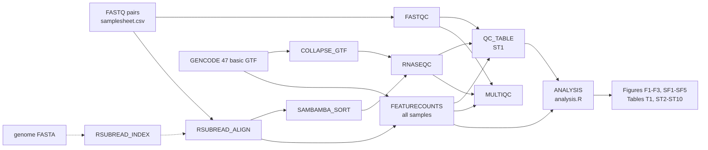

# RUDDS RNA-seq pipeline

Nextflow pipeline for the bulk RNA-seq analysis of the RUDDS lumbar disc
degeneration cohort (72 samples). Input: paired-end FASTQ files. Output: the
manuscript's figures and tables.

The pipeline is specific to this cohort. The raw data are not public.

- [Overview](#overview)
- [Quick start](#quick-start)
- [Requirements](#requirements)
- [Setup](#setup)
- [Input files](#input-files)
- [Running](#running)
- [Outputs](#outputs)
- [Reproducibility](#reproducibility)
- [Repository layout](#repository-layout)
- [Manual steps](#manual-steps)
- [License](#license)

## Overview



| Step | What it does | Tool |
|---|---|---|
| `RSUBREAD_INDEX` | genome index; skipped with `--rsubread_index` | Rsubread `buildindex` |
| `COLLAPSE_GTF` | one transcript per gene for RNA-SeQC; skipped with `--collapsed_gtf` | GTEx `collapse_annotation.py` |
| `FASTQC` | read quality per sample | FastQC 0.12.1 |
| `RSUBREAD_ALIGN` | paired-end alignment | Rsubread 2.20.0 `align` |
| `SAMBAMBA_SORT` | coordinate sort | sambamba 1.0.1 |
| `RNASEQC` | alignment QC (reverse-stranded) | RNA-SeQC 2.4.2 |
| `FEATURECOUNTS` | gene counts, all samples in one call | Rsubread 2.20.0 `featureCounts` |
| `QC_TABLE` | Supplementary Table 1 (FastQC, featureCounts, RNA-SeQC) | R |
| `MULTIQC` | one QC report | MultiQC 1.31 |
| `ANALYSIS` | the manuscript analysis, `scripts/analysis.R`, run whole | R 4.5, Bioconductor 3.21 |

The analysis covers:
- **Differential gene expression analysis:** DESeq2, adjusted for SVA surrogate variables.
- **Enrichment:** GO / KEGG over-representation, KEGG and miRNA GSEA.
- **Transcription factor activity:** decoupleR with CollecTRI.
- **Connectivity mapping:** search of LINCS drug perturbation signatures (signatureSearch)
  for compounds that reverse the disease expression signature.
- **Cell-type deconvolution:** BayesPrism with the Gan et al. (2021) disc scRNA-seq atlas.
- **ECM dysregulation subtypes:** classification of samples into the transcriptomic
  subtypes (C1-C4) of Jin et al. (2025), using their signature and classifier genes.

## Quick start

```bash
git clone <this repository> && cd <repository>
# put the input files into assets/ (see "Input files")
cd containers
apptainer build --fakeroot rudds-r.sif rudds-r.def
apptainer build --fakeroot rudds-collapse.sif rudds-collapse.def
cd ..
nextflow run main.nf -profile slurm,apptainer --rsubread_index /path/to/RSR_human_genome
```

## Requirements

- Nextflow ≥ 24.04 (Java 17+)
- Apptainer or Singularity
- A SLURM cluster, or one machine with the `standard` profile. Alignment ideally needs
  about 30 GB of memory per sample; the analysis needs 12 CPUs and 48 GB.
- Internet only on the first run, to pull the BioContainers images. The analysis
  itself runs offline: all its online resources are frozen in `assets/`.

`conf/slurm.config` is set for the original cluster: partition `common`, node
`mga-home`. Adapt `queue` and `clusterOptions` to your cluster.

## Setup

**Containers.** Build the two custom images once, from inside `containers/`:

| Image | Contents |
|---|---|
| `rudds-r.sif` | R 4.5, Bioconductor 3.21; CRAN packages pinned to the versions of the manuscript run (`r_cran_versions.tsv`); about 1 h to build |
| `rudds-collapse.sif` | Python 3.12 with numpy, pandas, bx-python, for `collapse_annotation.py` |

The other tools come from BioContainers. Apptainer pulls them on the first run
into `containers/cache/`.

**Assets.** Put the input files into `assets/` (next section). The folder is not
in the repository, as it holds sample data and third-party files.

## Input files

All inputs are read from `assets/`, which `--assets` can point elsewhere. The
folder is flat apart from the `ExperimentHub/` cache. Each file can also be set
on its own with the parameter given below.

**Sample data**

| File | Content | Parameter |
|---|---|---|
| `samplesheet.csv` | `sample,fastq_1,fastq_2` for the 72 samples; row order = column order of the counts | `--input` |
| `ST1_metadata.tsv` | first 7 columns of ST1: Name, Concentration, RIN, Condition, Level, Pfirrmann, Outlier (`yes`/`no`; the 15 `yes` samples are left out of the primary DGE) | `--st1_metadata` |
| `ST_safe_Sheets.tsv` | sample table of the analysis: RNA concentration, RIN, condition, sex, height, weight, age, BMI | `--sample_metadata` |
| `ST2_deconvolution.tsv` | BayesPrism cell-type fractions (ST2), used unless `--run_bayesprism` | `--deconvolution` |
| `ORA_layout_top_5_5.json` | hand-made layout of the ORA network (Figure 2) | `--ora_layout` |
| `ST1_QC_metrics.tsv` | ST1; read only with `--counts`, otherwise the pipeline builds it | `--st1` |

**References and external tables**

| File | Content | Parameter |
|---|---|---|
| `gencode.v47.basic.annotation.gtf.gz` | GENCODE 47 basic gene model (plain or gzipped) | `--gtf` |
| `40779_2025_637_MOESM3_ESM.xlsx` | Jin et al. (2025) supplementary table: subtype signature and classifier genes | `--jin_xlsx` |
| `*_OT-*-associated-targets-*.tsv` | Open Targets 26.03 targets for lumbar disc degeneration, lumbar disc herniation and intervertebral disc degeneration (exactly 3 files) | `--ot_files` |

```bash
wget -P assets https://ftp.ebi.ac.uk/pub/databases/gencode/Gencode_human/release_47/gencode.v47.basic.annotation.gtf.gz
```

**Frozen online resources**, so the results do not change with database updates:

| File | Content | Used for | Parameter |
|---|---|---|---|
| `CollecTRI_human.tsv` | CollecTRI TF-target network (OmniPath, 2026-06-26) | F3, ST8 | `--collectri` |
| `MSigDB_C3_MIRDB.tsv` | MSigDB 2026.1.Hs C3 MIR:MIRDB gene sets | ST9 | `--mirdb` |
| `KEGG_hsa_pathways.tsv` | KEGG human pathways (KEGG REST, 2026-11-12) | F2, ST5-ST7 | `--kegg` |
| `ExperimentHub/` | ExperimentHub cache (snapshot 2026-10-07): EH3226 LINCS scores (2.5 GB), EH3228 drug targets, EH3234 null scores. Keep the file names | ST10 | `--experimenthub` |

They are made by `scripts/freeze_downloads.R`, run once by hand with the
analysis R library and internet access. It takes CollecTRI, MSigDB and
ExperimentHub from the R packages' own caches when present, which keeps the
versions an earlier run used. KEGG has no cache, so it is always the current
release.

```bash
Rscript scripts/freeze_downloads.R assets            # existing files are kept; --force redoes them
```

**Given on the command line**

| Input | Parameter |
|---|---|
| FASTQ files | paths in `samplesheet.csv` |
| Rsubread index | `--rsubread_index <prefix>`, or `--fasta` to build it |
| Collapsed gene model (optional) | `--collapsed_gtf` |
| Existing featureCounts RDS (analysis only) | `--counts` |
| BayesPrism scRNA-seq reference (Gan et al. 2021) | `--bayesprism_ref`, with `--run_bayesprism` |

## Running

From the repository folder:

```bash
# Wiring check: every step as a stub (empty outputs), a few minutes
nextflow run main.nf -profile slurm,apptainer -stub \
    --rsubread_index /path/to/RSR_human_genome --outdir results_stub

# Full run from FASTQ
nextflow run main.nf -profile slurm,apptainer \
    --rsubread_index /path/to/RSR_human_genome -resume

# Analysis only, from existing counts (ST1 from assets/ST1_QC_metrics.tsv)
nextflow run main.nf -profile slurm,apptainer --counts /path/to/counts.rds
```

After a failed or changed step, `-resume` reruns only that step and the ones
after it. Keep the Nextflow head job running, e.g. in `screen`, `tmux` or its own
small SLURM job.

| Profile | |
|---|---|
| `slurm` | SLURM executor (`conf/slurm.config`) |
| `apptainer` | one container per step (`conf/apptainer.config`) |
| `standard` | local executor (default) |

| Parameter | Default | |
|---|---|---|
| `--assets` | `assets/` | folder of the input files |
| `--outdir` | `results` | output folder |
| `--rsubread_index` / `--fasta` | — | existing index prefix, or FASTA to build one |
| `--collapsed_gtf` | built | existing RNA-SeQC gene model |
| `--counts` | — | skip the upstream steps |
| `--run_bayesprism` / `--bayesprism_ref` | `false` | recompute ST2 (hours) instead of reading it |
| `--skip_analysis`, `--skip_multiqc` | `false` | |
| `--rsubread_container` | Rsubread 2.20.0 | BioContainers image for alignment and counting |

All parameters are in `nextflow.config`. Resources per step (CPUs, memory,
retries) are in `conf/base.config`.

## Outputs

In `--outdir` (default `results/`):

| Folder | Content |
|---|---|
| `fastqc/` | FastQC reports |
| `bam/`, `bam_sorted/` | BAM files (symlinks into `work/`) |
| `rnaseqc/` | RNA-SeQC metrics and gene tables |
| `counts/` | `RSR_counts.rds` (featureCounts result), `RSR_counts.summary` |
| `qc_table/` | `ST1_QC_metrics.tsv` |
| `multiqc/` | `multiqc_report.html` |
| `analysis/Results/` | figures (PNG + PDF) and tables of the manuscript, `sessionInfo.txt` |
| `analysis/ORA_layout_data.js` | data for `scripts/ora_layout_editor.html` (Figure 2) |
| `pipeline_info/` | run report, timeline, trace, DAG, `software_versions.txt` |

Manuscript items in `analysis/Results/`:

| Item | File |
|---|---|
| Table 1, cohort | `T1_cohort.tsv` |
| Figure 1, volcano plot | `F1_volcano` |
| Figure 2, ORA network | `F2_ORA_network` (`F2_ORA_network_draft` before layout) |
| Figure 3, TF network | `F3_TF_network` |
| SF1, outlier PCA | `SF1_PCA` |
| SF2, deconvolution | `SF2_deconvolution` |
| SF3, SF4, ECM dysregulation subtypes (Jin et al.) | `SF3_Jin_signature`, `SF4_Jin_classifier` |
| SF5, surrogate variables vs. heterogeneity | `SF5_SV_heterogeneity` |
| ST1, QC metrics | `qc_table/ST1_QC_metrics.tsv` |
| ST2, cell-type fractions | `ST2_deconvolution.tsv` (with `--run_bayesprism`) |
| ST3, ST4, DGE | `ST3_DGE_all_genes.tsv`, `ST4_DEGs.tsv` |
| ST5, ST6, ORA | `ST5_ORA_up.tsv`, `ST6_ORA_down.tsv` |
| ST7, KEGG GSEA | `ST7_GSEA_KEGG.tsv` |
| ST8, TF activity | `ST8_TF_activity.tsv` |
| ST9, miRNA GSEA | `ST9_GSEA_miRNA.tsv` |
| ST10, LINCS | `ST10_CMAP_LINCS.tsv` |

Also in `analysis/Results/`:
- `Fisher_DEG_OpenTargets.tsv`
- `QC_pilot_batch_stats.tsv` (Supplementary Note 1)
- `SV_*_clean57.tsv`
- `*_cluster_assignments.tsv`
- `RSR_counts.tsv`
- `gencode47_gene_table.tsv`

## Reproducibility

- **Software.** Every step runs in a fixed container. In the R image, CRAN
  packages are pinned to the exact versions of the manuscript run and BayesPrism
  to a fixed commit. `pipeline_info/software_versions.txt` and
  `analysis/Results/sessionInfo.txt` record what actually ran.
- **Databases.** CollecTRI, MSigDB, KEGG and the LINCS data are read from frozen
  copies, so the analysis does not depend on the current state of OmniPath,
  KEGG, Zenodo or ExperimentHub.
- **Randomness.** Seeds are fixed for GSEA, BayesPrism and label placement.

## Repository layout

```
main.nf               workflow: UPSTREAM (FASTQ -> counts, ST1) and ANALYSIS
nextflow.config       parameters and profiles
conf/                 resources (base), SLURM, Apptainer settings
modules/              one process per file
scripts/
  analysis.R          the manuscript analysis
  core_functions.R    its functions, and the ST1 parsers
  qc_table.R          Supplementary Table 1
  featurecounts.R, rsubread_align.R, rsubread_index.R
  collapse_annotation.py   GTEx gene-model collapsing (unchanged; BSD-3-Clause)
  freeze_downloads.R  makes the frozen online resources (manual)
  ora_layout_editor.html   browser editor of the Figure 2 layout (manual)
containers/           Apptainer definitions, pinned CRAN versions
assets/               input files (not in the repository)
LICENSE               MIT
LICENSES/             licenses of third-party code
```

`analysis.R` also runs on its own, e.g. in RStudio. It reads its inputs from
its own folder, under the same names as in `assets/` and in the pipeline output
(`RSR_counts.rds`, `ST1_QC_metrics.tsv`).

## Manual steps

These happen outside the pipeline:

- **ORA network layout (Figure 2).** The layout is arranged by hand in
  `scripts/ora_layout_editor.html`, a standalone page that runs in the browser.
  The layout of the manuscript is `assets/ORA_layout_top_5_5.json`.
  1. Copy the editor next to the data:
     `cp scripts/ora_layout_editor.html results/analysis/`
  2. Open `results/analysis/ora_layout_editor.html`, arrange the network and
     save the layout (`ORA_layout_top_5_5.json`).
  3. Rerun with `--ora_layout <file>`, or replace the file in `assets/`.
- **Open Targets tables.** Exported from the Open Targets Platform (release
  26.03) and placed in `assets/`.

## License

MIT, see [LICENSE](LICENSE). Exception: `scripts/collapse_annotation.py` is from the
[GTEx pipeline](https://github.com/broadinstitute/gtex-pipeline) and keeps its
BSD 3-Clause license ([LICENSES/BSD-3-Clause-GTEx.txt](LICENSES/BSD-3-Clause-GTEx.txt)).
